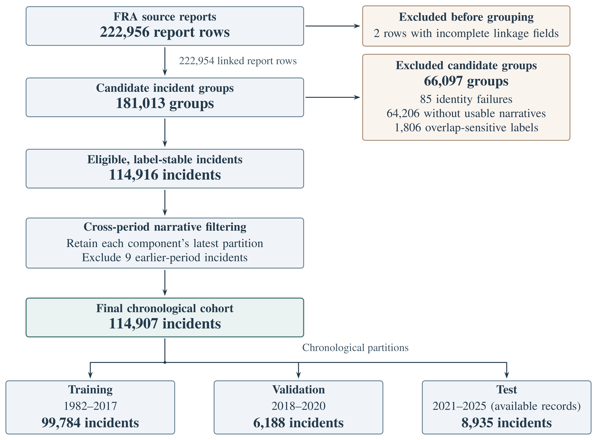

# Railway accident report classification

This repository contains the code, incident-cohort definitions, chronological splits, and saved predictions for **Chronological evaluation of gated fusion for railway accident report classification**. The study compares text-only RoBERTa, representation concatenation, and Vector Calibration Fusion (VCF) for retrospective classification of completed railway accident reports.

VCF uses a structured representation to attend to narrative tokens and applies a dimension-specific gated correction to concatenated structured and textual summaries. The target is an adapted three-category composite index of reported accident consequences. It is not a validated official severity grade or a prospectively evaluated accident forecast.

## Study data and chronological partitions

The incident cohort is derived from an archived Federal Railroad Administration (FRA) Form 54 extract. Incident grouping, overlap-bound label checks, and cross-period filtering of recognized repeated narratives yield 114,907 retained incidents.

| Partition | Incident years | Incidents |
|---|---|---:|
| Training | 1982–2017 | 99,784 |
| Validation | 2018–2020 | 6,188 |
| Test | Available 2021–2025 records | 8,935 |

The completeness of the available 2025 records is unknown. Cross-period narrative filtering retains incidents in each recognized component's latest represented partition; it does not remove every repeated narrative within that partition.



Figure files: [vector PDF](figures/cohort_flow.pdf) and [editable TikZ source](figures/source/Figure_1_Cohort.tex).

## Saved test results

The neural results below are means and sample standard deviations across seeds 62, 63, and 64. Macro-F1 uses the zero-to-one scale.

| Configuration | Mean macro-F1 | Sample SD |
|---|---:|---:|
| Text-only RoBERTa | 0.818549 | 0.002492 |
| Concatenation | 0.817544 | 0.004510 |
| VCF | 0.819326 | 0.002918 |

The mean VCF-minus-text difference is **0.078 percentage points**, with a paired component-bootstrap 95% interval of **−0.344 to 0.480 percentage points**. This post-test interval conditions on the fitted models and recognized narrative components; it excludes retraining uncertainty and does not establish equivalence. The results provide limited evidence of a consistent aggregate benefit from structured fusion under the evaluated training budget.

All thirteen final prediction files, covering four classical baselines and nine neural runs, are in [`results/final/`](results/final/). Summaries and post-test analyses are in [`analysis/v14/`](analysis/v14/). The 2021–2025 test records have been evaluated and should not be described as an untouched holdout in subsequent work.

## Verify saved results on a CPU

Verification does not require the raw CSV, PyTorch, model checkpoints, pretrained weights, or a GPU. Use a separate environment; Python 3.10 is recommended for the pinned verification dependencies.

Create and activate the environment using the commands for your terminal.

**Windows PowerShell**

```powershell
py -3.10 -m venv .venv
.\.venv\Scripts\Activate.ps1
```

**Linux or macOS**

```bash
python3.10 -m venv .venv
source .venv/bin/activate
```

Then run from the repository root:

```bash
python -m pip install -r requirements-verify.txt
python scripts/verify_results.py
```

The expected final line is:

```text
PASS: all 13 final prediction files
```

The script checks common incident identities, labels, probability consistency, confusion matrices, macro-F1, and accuracy. Recalculating saved predictions is distinct from replaying checkpoints or reproducing training.

## Reproduce the post-test analyses

See [`analysis/v14/README.txt`](analysis/v14/README.txt) for the audit definitions. From the repository root:

```bash
python analysis/v14/summarize_final.py --repo . --out work/summary_v14
python analysis/v14/audit_target.py --repo . --raw-zip datanew_snapshot.zip --out work/target_audit_v14
```

Use a new output directory for the target audit. The summary uses NumPy and saved predictions; the target audit uses the standard library and the archived raw ZIP. These commands do not train models or modify archived predictions. Keyword matches can include negation or vague wording and do not prove disclosure of a target category.

Key archived outputs:

- [Final model summary](analysis/v14/results/final_summary.csv)
- [Conditional bootstrap estimate](analysis/v14/results/bootstrap.json)
- [Target and narrative audit](analysis/v14/results/audit.json)
- [Severity-criterion counts](analysis/v14/results/label_triggers.csv)
- [Narrative-wording counts](analysis/v14/results/mention_summary.csv)

## Training and evaluation reproduction

See [`docs/REPRODUCIBILITY.md`](docs/REPRODUCIBILITY.md) for the full workflow and its verification boundaries. The recorded experiment used Python 3.8.20, PyTorch 2.0.0+cu118, Transformers 4.46.3, and scikit-learn 1.3.2 on an RTX 4090 with 24 GB memory.

[`requirements.txt`](requirements.txt) records the core experiment dependencies. [`environment/pip-freeze.txt`](environment/pip-freeze.txt) contains the collected package list; it is not a complete environment lockfile. PyTorch and the RoBERTa model files require separate setup. The maintained scripts and the structured-model modules are already included under [`src/`](src/), including [`src/original_model/`](src/original_model/).

Fresh training is stochastic and is not required to reproduce the archived scores exactly. Independent checkpoint replay, full training reproduction, comparative runtime measurements, and isolated component-ablation benefits have not been established by the saved-result verification.

## Data snapshot and provenance

The raw CSV is currently tracked in [`datanew_snapshot.zip`](datanew_snapshot.zip). Cohort metadata and duplicate-component records are already present under [`data/`](data/). To extract the CSV from a Bash terminal:

```bash
mkdir -p data/raw
unzip -n datanew_snapshot.zip -d data/raw
```

The exact raw file is identified in [`data/raw_snapshot.json`](data/raw_snapshot.json):

```text
datanew.csv
158,327,293 bytes
SHA-256: 9271f04027d907ae9c47d1de2d38a1b1ddf4eb64fcae177b9f62faa21be02e19
```

The upstream reference is the [DOT FRA Form 54 data portal](https://data.transportation.gov/Railroads/Railroad-Equipment-Accident-Incident-Source-Data-F/aqxq-n5hy). The original export date and query were not recorded. A new portal download may differ from this snapshot. The archived hash identifies the study file but does not independently validate the source reports, incident links, or any local additions.

## Repository guide

| Path | Contents |
|---|---|
| [`src/`](src/) | Cohort preparation, models, training, and evaluation scripts |
| [`results/final/`](results/final/) | Thirteen final prediction files, metrics, completion record, and frozen protocol |
| [`results/development_baselines/`](results/development_baselines/) | Development results and the incident split manifest |
| [`data/`](data/) | Candidate labels, recognized narrative links, and raw snapshot metadata |
| [`analysis/v14/`](analysis/v14/) | Post-test target audit, summaries, and conditional uncertainty analysis |
| [`scripts/`](scripts/) | Saved-prediction verification |
| [`environment/`](environment/) | Collected environment record |
| [`figures/`](figures/) | Cohort flowchart and editable source |
| [`docs/REPRODUCIBILITY.md`](docs/REPRODUCIBILITY.md) | Detailed reproduction instructions |

The root `Railway_GitHub_Ready.zip` is a preparation archive. Use the current repository files and this README for the maintained workflow.

## Attribution, citation, and licensing

**Repository maintainer:** Bilal Rafique, PhD Scholar, Computer Science, Southwest Jiaotong University. Contact: bilalrafique@my.swjtu.edu.cn. [`AUTHORS.md`](AUTHORS.md) records affiliations and code attribution; [`CITATION.cff`](CITATION.cff) provides the current software citation. Manuscript author order and the complete paper citation require author agreement.

The repository is publicly accessible. A software license has not yet been agreed, and the authors still need to confirm the data-redistribution status. No blanket code or data license is asserted here. Pretrained model weights are not redistributed in this repository.

When reporting a reproduction, record the exact commit and the data snapshot hash. The archived experiment and post-test analysis reviewed here are at commit `2e5f42c9429c92847fbe9b66b69cb61b562204bd`.
